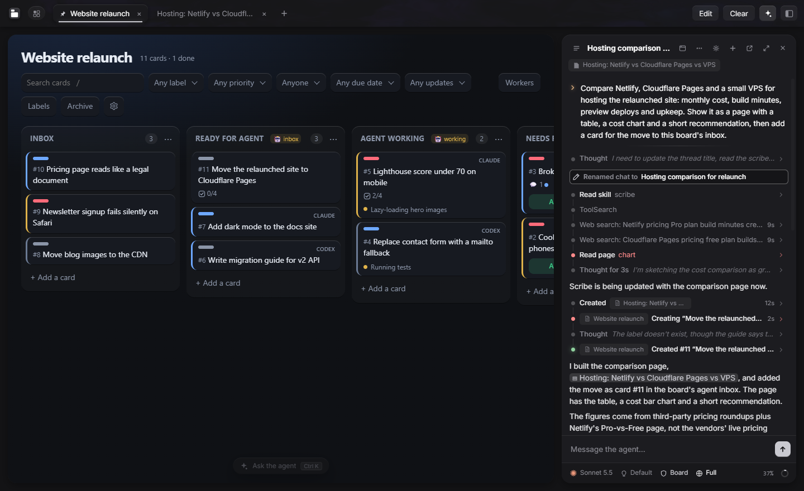
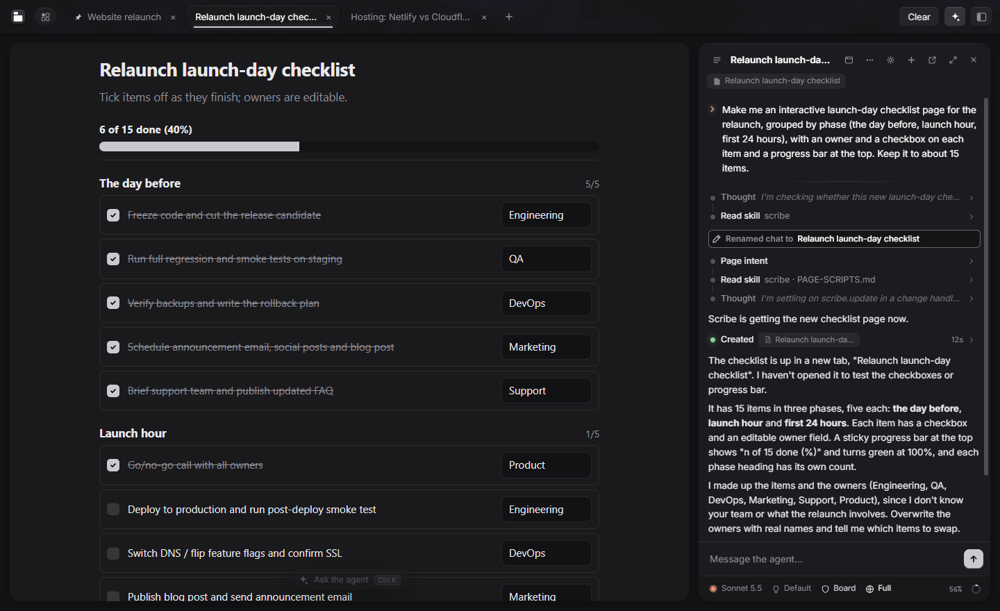
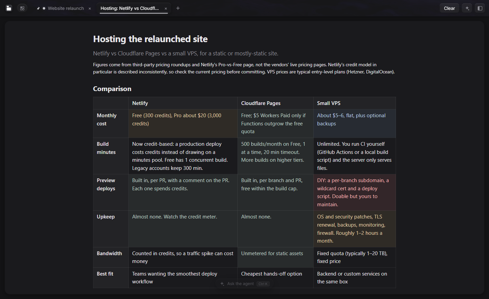

# Scribe

**A desktop app where you and your AI agents work on the same pages.**

Ask an agent to compare three options, plan a launch or look into a bug, and the answer opens as a page next to your notes instead of a wall of text in a chat. Pages can be interactive: a form the agent waits on, a checklist you tick off, a Kanban board the agents take work from. Every page is kept in your Library, on your own machine.

Scribe runs the agents you already use (Claude, Codex, Cursor) and any OpenAI-compatible model, including local ones.



## What you can do with it

- **Answers as pages.** Agents make pages: comparison tables, charts, reports, design mockups. They open as tabs, stay in your Library, and the agent can update them later instead of starting over.
- **Work on the same page.** Pages keep their own data. When you tick items, fill in a form or move a card, the agent can read it, and you see its changes as it makes them.
- **One chat for every agent.** Claude, Codex, Cursor and your own models share one chat, with plan usage and costs shown as you go. The chat follows the page in front, so "make this shorter" means this page.
- **Hand work to agent workers.** Assign cards on a Kanban board to an agent worker. It takes them one by one, and in a code project it can work on its own git branch and merge the finished work back.
- **Stay in control.** Every chat has an access level, from read-only to full access, and asks before it does anything you have not allowed. You can review each turn's changes and undo them.
- **Keep it local.** Your pages, chats and settings live in one data folder on your computer. There is no Scribe account and no Scribe cloud; only the model providers you choose see your prompts.
- **Use it on all your devices.** Pair your PCs over your network or Tailscale, or reach Scribe from any browser through a server.



## Install

### Windows (desktop app)

1. Download `Scribe_<version>_x64-setup.exe` from the [latest release](https://github.com/SirVeggie/scribe/releases/latest), or [build it yourself](#build-from-source).
2. Run it. It installs for your user only (no admin rights) and includes everything it needs.
3. Start Scribe. A short setup guide helps you connect your agents and pick a theme. You can skip any step and come back to it under Settings → Help → Setup guide.

Scribe checks for updates itself. Under Settings → Updates you choose whether it installs them automatically, asks first, or never checks.

### What you need for the agents

Scribe doesn't come with a model of its own. Connect at least one of these in Agent settings (**Ctrl+Shift+,**):

| Agent | What you need |
|---|---|
| **Claude** | A Claude plan (**Log in** in Agent settings), or an Anthropic API key |
| **Codex** | A ChatGPT account (**Log in** in Agent settings) |
| **Cursor** | A Cursor account (**Log in** in Agent settings) |
| **Other models** | Any OpenAI-compatible endpoint, such as OpenRouter, LM Studio, Ollama or llama.cpp, or an API key for OpenAI, Anthropic, Gemini and others. Scribe calls these **Native**. |

### Linux and macOS

There is no desktop app for Linux or macOS yet. On Linux (x86_64, with systemd) and macOS you can run Scribe as a background service and use it in your browser:

```sh
curl -fsSL https://github.com/SirVeggie/scribe/releases/latest/download/install.sh | sh
```

Then open <http://127.0.0.1:4747>. This is also how you set up an [always-on server](#an-always-on-server).

## First steps

Press **Ctrl+T**, choose **Ask the agent**, and type "Make a packing checklist for a weekend hike". The checklist opens as a tab and stays in your Library. Tick a few items, then ask "what's left?".

A few keys get you around:

| Key | What it does |
|---|---|
| **Ctrl+K** | Floating chat over the current page |
| **Ctrl+L** | Chat in the sidebar (**Ctrl+Shift+L** for the full window) |
| **Ctrl+T** | New page: notes, a todo list, a Kanban board, or ask an agent |
| **Ctrl+B** | Library: every page, in folders you arrange |
| **Ctrl+D** | Search pages, their contents and your chats |
| **Ctrl+E** | Spaces: separate sets of tabs, such as home and work |
| **Ctrl+H** | Help: ask how to do anything in Scribe |

More to try:

- Open a Kanban board from **Ctrl+T**, add a card, then ask the chat to break it into smaller cards.
- To let a chat work on your code, pick a project folder and the **Edits** access level from the bar under the message box. In a git repository you can review and undo the changes from each turn.



## Use Scribe's pages from other tools

Scribe is also an MCP server, so agents outside it (Claude Code, Cursor, Codex or any MCP client) can show you pages and read what you did on them. With the desktop app installed, add this to the client's MCP settings, with `<you>` replaced by your Windows user name:

```json
{
  "mcpServers": {
    "scribe": {
      "command": "C:\\Users\\<you>\\AppData\\Local\\Programs\\Scribe\\app\\node\\node.exe",
      "args": ["C:\\Users\\<you>\\AppData\\Local\\Programs\\Scribe\\app\\dist\\index.js"]
    }
  }
}
```

The server starts Scribe if it isn't running. Then ask the agent to "show this in Scribe".

## Using several devices

Each device runs its own Scribe and keeps its own pages and chats. Pairing connects them: the space picker (**Ctrl+E**) lists the spaces of every paired device, and opening one shows that device's pages and chats in your window. You can copy pages, folders and templates between devices, and when a chat on another device needs your approval or answer, you see it where you are.

Devices connect to each other directly, encrypted. They need to reach each other on your local network, over a VPN such as Tailscale, or through an always-on device that relays for them.

### On the same network, or with Tailscale

1. Install Scribe on both devices.
2. If they are not on the same network, install [Tailscale](https://tailscale.com/download) on both and sign in to the same account. Scribe finds Tailscale addresses on its own.
3. On the first device, open Settings → Devices → **Add device**. It shows a pairing code and a QR code.
4. On the second device, open Settings → Devices → **Enter code** and type the code.
5. Both devices show four words. Check that they match.

Paired devices introduce each other, so a third device only needs to pair with one of them.

### An always-on server

A Linux (x86_64) or macOS machine that stays on, such as a home server or a VPS, can do more for your other devices:

- **Relay**: devices that can't reach each other directly connect through it. The connection stays encrypted end to end; the server only passes it on.
- **Offline mirror**: it keeps a read-only copy of a device's open pages and chosen folders, so you can still read and copy them while that device is off.
- **Browser access**: it can serve Scribe to any browser, such as your phone.

To set it up:

1. Run the install script above on the server. It starts Scribe as a background service: a systemd user service on Linux, or a launchd agent on macOS that starts at login. If it prints a command to make Scribe start at boot, run that too. It puts the `scribe` command in `~/.local/bin`; if your shell can't find `scribe`, use `~/.local/bin/scribe` below.
2. Make sure your PC can reach the server: on the same network, or with Tailscale on both.
3. On the server, run `scribe add-device` and enter the code it shows on your PC (Settings → Devices → **Enter code**).
4. Optional, for devices that are not on your network or tailnet: point a host name you control at the server's public IP, run `scribe public-address <host name>` on the server, and allow incoming TCP on its peer port (`4748` by default). If the server is behind a router, forward that port to it.
5. To keep a mirror of your PC on the server, choose the server under Settings → Devices → **Offline mirror** on the PC, and mark folders as Mirrored from their menu.

### Browser access from anywhere

With a domain of your own and a TLS proxy such as [Caddy](https://caddyserver.com) on the server, you can open Scribe in any browser, including on your phone, after signing in with a Google account you allowed. See [docs/web-access.md](docs/web-access.md) for the setup.

## Build from source

You need [Node.js](https://nodejs.org) 22.19 or newer, and a [Rust toolchain](https://rustup.rs) for the desktop app.

```sh
git clone https://github.com/SirVeggie/scribe.git
cd scribe
npm install
npm run build
npm start              # the background service; then open http://127.0.0.1:4747
npm run desktop        # or build and run the desktop app
```

A copy built from git updates itself by pulling and rebuilding. [docs/reference.md](docs/reference.md) covers how Scribe works inside: the page API, the agent tools, the chat, the desktop app and the data folder. The [docs](docs) folder has design notes for individual features.
