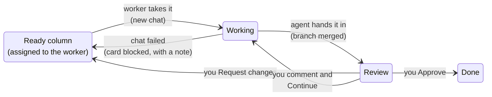

# Kanban agent workers

A Kanban board can hand its cards to **agent workers**: named agents that take the cards assigned to them, do the work in a chat of their own, and hand each card back. This page explains how a card moves through a worker and why a worker might be waiting.

## Setting up a worker

Open the board's **Workers** button and add a worker. Each worker has:

- a **name** and color: cards are assigned to workers by name, like to a person;
- its **agent settings**: provider, model, reasoning effort, [access level](permissions/chat-access.md), Web, and the project folder it works in;
- whether it works in its own **git worktree** (recommended for code: see below);
- **instructions** of its own, added after the board's shared instructions;
- a **run switch**.

The board needs the page permission **Agents with file and shell access** for the worker's folder (see [Page permissions](permissions/page-permissions.md)). It asks the first time.

## How a card moves

1. **Pick-up.** A running worker takes the cards in the board's ready columns that are assigned to it, top first. For each card it starts a **fresh chat**, with the shared and worker instructions and the card itself (description, checklist, recent comments), so no chat carries the whole run's history.
2. **Work.** The card moves to the working column and shows the agent's status. Comments you post on the card go straight into the running chat.
3. **Hand-in.** The agent posts a summary and the card moves to review. In a worktree, the board then rebases the worker's branch onto the branch it came from and merges it, so the next card starts from the latest work.
4. **Review.** **Approve** moves the card to done. **Request changes** sends it back to its ready column with your note, and the worker picks it up again.

After a chat has ended, a new comment on its card offers **Continue**: the same conversation gets the card back and goes on from where it was.

## Worktrees

A worktree is a separate checkout of your repository on a branch of its own, kept in Scribe's data folder. Each worker chat gets one, so several workers can change the same project at once without stepping on each other or on your own uncommitted work.

- The board merges a worker's branch when its chat ends. If the merge has conflicts, the board asks the agent, in the same chat, to rebase and resolve them, then tries again. If it still won't merge, the card goes back to its ready column, blocked.
- When another worker's merged branch touched the same files, the board tells the running agent which files and which card, so it can check its own work still fits (Workers → **Overlap notices**).
- Folders like `node_modules` are linked from your main checkout into each worktree instead of copied. Because of that, don't delete a worktree folder by hand or run `npm install` inside one: that goes through the link and changes your main checkout. Use the chat's branch menu (**Merge**, **Leave branch**, **Discard worktree**) instead.
- A worker without a worktree works directly in its folder. Then only one such worker should run on a folder at a time.

## Limits and timing

| Setting | Effect |
|---|---|
| **Max parallel** | How many worker chats run at once, across all workers |
| **Per provider** | How many of those may use the same provider (default 1), so you don't run into one plan's usage limit with five chats at once |
| **Start after** (on a card) | The earliest time a worker may take it |
| **Blocked by** (on a card) | Cards that must be done first |
| Pausing an inbox (click its tag) | Workers skip that ready column |

If a provider's plan usage limit stops a chat, the card stays with it, and the board sends the same chat on once the limit resets.

Workers run inside Scribe's background service, so they keep going when the board isn't open, or when the desktop app is closed to the tray.

## Why isn't my worker taking a card?

Check, in order:

1. Is the card in a **ready** column, and assigned to the worker by name?
2. Is the worker's **run switch** on?
3. Is the ready column **paused**?
4. Is the card waiting on **Start after** or a **Blocked by** card?
5. Are **Max parallel** or **Per provider** slots all taken?
6. Is the provider waiting out a **usage limit**?
7. Does the board have the **page permission** for the worker's folder?

The Workers panel's **log** records every start, pause, merge, wait and failure, and usually says which of these it is.

## Other ways to run an agent on a card

- **Right-click → Run** runs one worker on just that card, outside its normal queue (it still counts toward the limits).
- **Ask**, on a comment, starts a separate chat that answers a question about the card without taking or moving it. It uses the worker set as **Default model** in the Workers panel.
