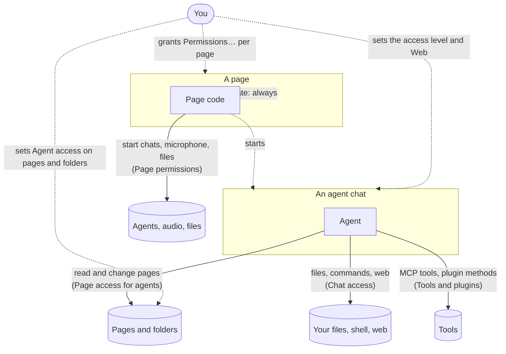

# Permissions in Scribe

Scribe has several permission systems. Each one answers a different question, and they stack: an action goes ahead only when every layer that applies to it allows it. This page maps them; each layer has its own page with the details.

| Question | Layer | Where you set it | Details |
|---|---|---|---|
| What may this chat's agent do (read, change pages, edit files, run commands, use the web)? | **Chat access** | The access and Web controls under the chat's message box | [Chat access](permissions/chat-access.md) |
| Which pages and folders may this chat's agent see and change? | **Page access for agents** | Page or folder menu → **Agent access** | [Page access for agents](permissions/page-access.md) |
| What may a page's own code do (start agents, use the microphone, read files)? | **Page permissions** | Page menu → **Permissions…** | [Page permissions](permissions/page-permissions.md) |
| Which MCP tools and plugin methods may run? | **Tools and plugins** | Agent settings → MCP servers, Settings → Plugins | [Tools and plugins](permissions/tools-and-plugins.md) |
| What may other devices, and their agents, do here? | **Devices** | Settings → Devices | [Devices and web access](permissions/devices.md) |

## How they fit together

Two kinds of actors ask for things: **agents** (in a chat, or a chat a page started) and **page code** (the scripts inside a page). You decide for both.

Some examples of layers working together:

- **A chat in Full access** can run any command in its workspace without asking, but it still can't open a page set to *Ask always* unless you allow that, because page access is a separate layer.
- **A Kanban board's workers** are chats the board starts. The board needs the page permission *Agents with file and shell access* for the worker's folder, and each worker chat then has its own access level, set in the worker's settings.
- **A plugin method an agent calls** needs the chat's access level to be high enough for that method, and a page's *Deny* for that plugin always wins.

## When Scribe asks

Most layers ask in the chat, as a card with buttons, when something isn't allowed yet. The usual answers:

| Answer | Lasts |
|---|---|
| **Allow once** | This one call |
| **Allow for this thread** | Until the chat ends; you can take it back from the thread's menu → **Permissions…** |
| **Always allow …** | For every chat (an MCP tool), or every chat on that page or folder (page access) |
| **Deny** | This call; the agent is told and carries on without it |

Page permissions ask with a dialog over the page instead: **Allow**, **Deny**, or **Not now** (asks again later).

A chat that runs with nobody watching, such as a Kanban worker, can't wait forever. When an agent asks for web or page access, it says how important it is, and an unanswered request is refused after a while:

| Importance | Waits for an answer |
|---|---|
| necessary | Until you answer |
| important | 2 hours |
| useful | 15 minutes |
| trivial | 2 minutes |

## Where grants are kept

All grants stay on the device that made them. They are not part of a page's HTML, state or export, so sharing a page or copying it to another device never carries its grants along. When an agent rewrites a page's code, the riskier page permissions go back to *Ask* (see [Page permissions](permissions/page-permissions.md#when-grants-reset)).
