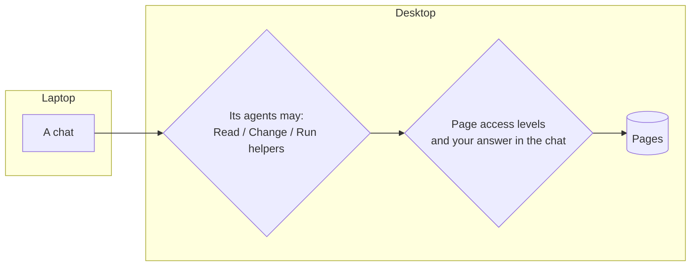

# Devices and web access

[← Permissions overview](../permissions.md)

When you pair devices (see [Using several devices](../../README.md#using-several-devices)), three questions come up: what may the *other device* do here, what may *its agents* do here, and who may use Scribe *from a browser*.

## A paired device is you

Pairing is a statement that both devices are yours. A paired device can do everything you can do locally: open this device's spaces, read and change its pages, use its chats, copy things back and forth. That is why pairing takes a one-time code and a check that both devices show the same four words.

To take that trust back, open Settings → Devices and **Revoke** the device (or `scribe unpair <name>`). It can't connect again unless you pair it anew.

## Agents on other devices

The trust between devices does not pass to their agents. A chat on your laptop can't touch your desktop's pages until the desktop allows it. In Settings → Devices, each paired device has a row **Its agents may**:

| Box | Lets that device's chats |
|---|---|
| **Read pages** | Read pages here |
| **Change pages** | Change pages here |
| **Run helpers** | Start helper agents here, which work in a folder on this device with this device's accounts |

All three are off until you tick them. Even with them on, a remote chat is treated like a chat with no Scribe access of its own: it lists what it could ask for, and opens a page only when you allow it in that chat, when you wrote the page's key in the chat, or when the page is *Open*. This device's own [access levels](page-access.md#access-levels) still apply, and a chat that read a *Trusted only* page here is marked on the other device too. Helpers there ask you once per folder, and their approvals show on that device and as notices where you are.

## Web access

[Web access](../web-access.md) lets a browser anywhere open Scribe through an always-on server. Here the sign-in is the boundary:

- Only the Google accounts you list can sign in. Each sign-in is a browser session that lasts 30 days after its last use.
- A signed-in browser is you: it can do what a paired device can, including changing settings, except revoke devices.
- Settings → Devices → **Web access** lists the signed-in browsers, with **Sign out** for each. Removing an account signs all of its browsers out.

## Under the hood

The board's HTTP API only answers on this machine's loopback address. Scribe tells callers apart by how they arrive: your windows (the board UI), chats (each with a token for its own thread), page scripts (each on an origin of its own, reaching only its own page) and other devices (over the encrypted peer connection, with keys exchanged when you paired). Sandboxed chats reach a separate port where every caller counts as an agent. [docs/reference.md](../reference.md) and [docs/cross-device-design-892.md](../cross-device-design-892.md) have the details.
