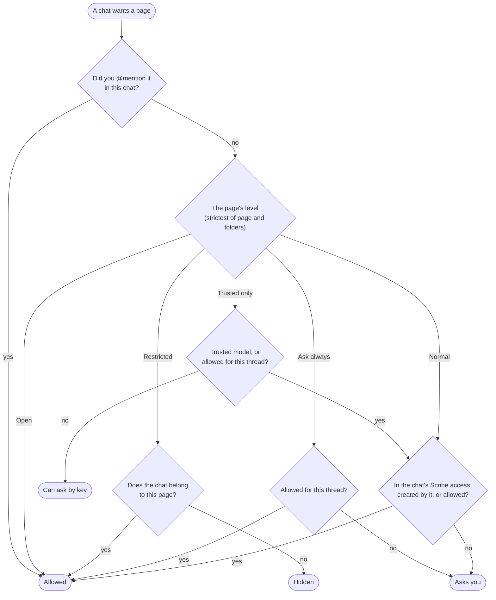

# Page access for agents

[← Permissions overview](../permissions.md)

This layer decides which pages and folders a chat's agent may see and change. It works on its own: a chat's [access level](chat-access.md), even Full access, doesn't open a page this layer keeps closed. Only your answer, or your mention of the page, does.

## A chat's Scribe access

Every chat belongs somewhere, shown on the chip at the top of the chat. That is its **Scribe access**, and it is where the chat can work without asking:

| Scribe access | The chat reaches, without asking |
|---|---|
| **This page** | The page, and pages it creates |
| **This folder** | Every page in the folder and its subfolders |
| **Global** | Every page in the Library (except the stricter levels below) |
| **None** | No pages at all (a chat for files only) |

Change it with the chip, **Ctrl+Shift+.**, or the `/here`, `/folder` and `/global` commands. It is separate from the chat's *workspace*, the folder on disk it works in.

On top of that, a chat reaches:

- pages it created itself, and pages created from its page or folder;
- pages you `@`mention in a message, whatever their level;
- pages whose key (`scribe:some-page`) you wrote in a message, for reading;
- pages linked from a Kanban card it holds, for reading;
- pages and folders you allowed it to reach (below).

## Access levels

Each page and folder has an access level, set from its menu → **Agent access**:

| Level | Who reaches it |
|---|---|
| **Open** | Every chat, without asking. For reference pages such as a style guide |
| **Normal** (default) | Chats whose Scribe access covers it; other chats ask |
| **Ask always** | Every chat asks first, even global ones |
| **Trusted only** | Only chats on a [trusted model](#trusted-models). Other chats don't see it listed, and can only ask for it by its key |
| **Restricted** | Only a chat that belongs to that exact page. Every other chat sees nothing, as if the page didn't exist |

The strictest level wins: a Normal page in a Restricted folder is Restricted. **Hide from agent** (in a page's menu) is the same as Restricted. The Library shows an icon on pages and folders with a level other than Normal, dimmed when it comes from a parent folder.

## When a chat asks

A chat that needs a page outside its reach asks in the chat (the `page_access` tool), saying why and how important it is:

- **Allow for this thread**: this chat may read and change it until it ends.
- **Always allow for *page or folder***: every chat on the chat's own page or folder may reach it from now on. This grant is stored on that page or folder; its menu → **Agent access** lists the grants and removes them.
- **Deny**.

*Ask always* and *Trusted only* pages offer only **Allow for this thread**, never Always. A *Restricted* page can't be asked for at all: `@`mention it in the chat to let that chat in.

## Trusted models

*Trusted only* exists for pages you don't want sent to every model provider. A model is trusted when it comes from a Native model source you marked **Trusted** in Agent settings → Providers (a model you host yourself, for example). Claude, Codex and Cursor models are never trusted.

A chat that read a *Trusted only* or *Restricted* page without your mention is marked as holding that content. From then on Scribe asks you before the chat switches to an untrusted model, or hands work to a helper on one, because the content would go to that model too.

## Page code and other pages

A page's own scripts reach other pages through a narrower rule: their own page, plus *Normal* and *Open* pages that their page or its folders were granted with **Always allow**. They never reach *Ask always*, *Trusted only* or *Restricted* pages. What else a page's code may do is decided by [Page permissions](page-permissions.md).
